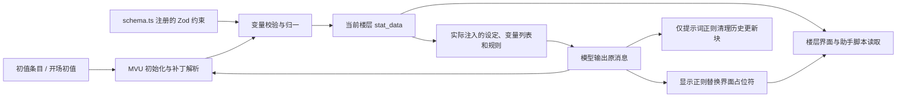

# 复杂卡模块联动

复杂卡可能同时包含多个人物与世界书、持续状态、条件提示、脚本或多个界面，不以模块数量划定能力。下面以 MVU 状态卡说明协作关系；没有 MVU 的卡可以只使用需要的部分。改之前定位实际的生产者和消费者，改完核对所有受影响的路径。

## 依赖链



对应到文件：

| 环节 | 落在哪里 | 谁读它 |
| --- | --- | --- |
| 变量结构 | `src/schema.ts`；`src/variables/schema.json` 仅作投影 | Zod 注册脚本、编辑器参考 |
| 初始值 | `[initvar]` 世界书条目引用的正文；可选开场 `<initvar>` 块 | MVU 初始化，不由模型猜测 |
| 变量规则与输出协议 | 世界书条目（固定四条目） | 模型 |
| MVU 与注册器 | 脚本条目 + 固定提交外链 | 浏览器运行时 |
| 输出标签 | 模型消息正文 | MVU 解析器、正则 |
| 提示词清理 / 显示渲染 | `src/regex/*.yaml` 与 `替换文件` | 宿主正则扩展 |
| 界面 | `src/ui/vue/` 或 `src/ui/html/` | 助手脚本与楼层渲染 |
| 脚本逻辑 | `src/scripts/*.yaml` 与 `文件` | 浏览器 iframe |

## 定位内容

按从大到小的顺序缩小范围，不要直接翻整张卡：

1. `pnpm card map <名称>`：打印创作入口、设置文件、正文文件、构建项，以及已取消引用的原条目。
2. 卡根 `内容导航.md`：工具生成的内容落点导航；它是说明书，不是编辑入口。
3. `cards/<名称>/src/index.yaml`：`文本`、`备选开场白`、`世界书`、`正则`、`脚本` 各引用哪些文件。
4. 对应条目 YAML：开关、关键词、顺序、位置、`构建` 写在 YAML 里，正文在 `文件`／`替换文件` 指向的 `src/...`。
5. `pnpm inspect-card <JSON或PNG>`：对导入的大卡或成品做只读摘要；用 `--entries` 看条目索引，用 `--entry <id>` 只读必要正文。
6. `pnpm card diff <名称>`：导入卡改完后确认没有意外差异，并列出待构建项。

## 改一个功能的顺序

**加一个状态或字段**：`schema.ts` 结构 → `[initvar]` 条目实际引用的初值文件（以及各开场覆盖值）→ 更新规则条目 → 界面读取（如有）→ `pnpm card check`。变量列表使用固定宏读取当前状态，不手抄字段或替换协议；`schema.json` 是参考投影，需要时同步生成。

**改输出协议**（标签名、字段名、操作类型）：先核对锁定的 MVU 解析器是否支持，再改输出约定、相关正则与测试。普通功能修改沿用固定协议；单改提示词不会让解析器认识新操作。

**加一个界面**：`src/ui/vue/` 或 `src/ui/html/` 源码 → 条目 YAML 上的 `构建` → 正则的 `替换文件` → 占位符标签的产出条目 → 显示正则的深度与作用范围。

**改提示词文本**：先加载 [提示词文体](../.agents/skills/tavern-prompt-style/SKILL.md)，再确认同一段设定是否还散落在卡字段、变量初值或开场白描述里，改一处要同步其余位置。

## 容易踩的顺序陷阱

- 脚本列表顺序只是管理顺序，网络 import 与初始化是异步的；读写 MVU 前要等全局初始化完成，见 [助手脚本与 EJS](SCRIPTS.md)。
- 世界书 `顺序` 与 `位置` 是注入顺序，和条目列表的显示顺序不是一回事；拖动列表只同步 `display_index`。
- 世界书的 position／depth 与正则的 placement／depth 是两套系统，不能互相套用。
- 界面占位符必须有配对的正则消费，标签的生产者、消费者和历史处理要成对登记，见 [世界书条目提示词](WORLDBOOK-WRITING.md)。
- 变量被读取前必须有写入路径；变量、宏和条目没注入时按未知处理，给默认行为。

## 参考示例

| 示例 | 覆盖的模块 |
| --- | --- |
| `cards/示例-雾港调查局/` | 世界书 + MVU + Vue 界面 + 脚本 + 正则 + 多开场白；复杂卡的完整链路 |
| `cards/示例-MVU-Zod-Vue/` | 当前 MVU 模板：Zod 注册链、固定四条目与流式正则 |
| `cards/示例-世界书创作/` | 只有世界书、正则与脚本的轻量结构 |
| `cards/示例-独立状态栏/`、`cards/示例-脚本/` 等 | 旧版迁移示例，按需参考单一模块做法 |

示例卡是参考实现，不是必须照抄的骨架。它们的数据模型、条目划分与文件名只属于那张卡；新卡先确定体验目标，再决定复用哪一部分。

## 验证

```powershell
pnpm card check <名称>
pnpm card build <名称>
pnpm card diff <名称>
```

`check` 检查结构与语法，`build` 产出到 `dist/<名称>/`，两件都不代表真实酒馆能运行。看到的正则流式效果、MVU 解析、界面渲染和脚本事件，只有真实宿主环境能确认；没做过就保持 `runtimeVerified: null`，并在报告里写清未验证的部分。检查覆盖范围见 [验证](VERIFICATION.md)。
