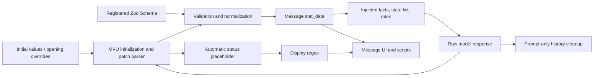

# Connecting complex-card modules

A complex card may combine characters/worldbooks, persistent state, conditional prompts, scripts, and multiple interfaces. Complexity is not a module count. Locate actual producers and consumers before editing; use only the relevant parts for non-MVU cards.

| Link | Source | Consumer |
| --- | --- | --- |
| State structure | src/schema.ts; optional schema.json projection | registration script/editor |
| Initial state | `[initvar]` worldbook body; optional opening `[initvar]` block | MVU |
| Rules/protocol | four standard entries | model |
| Framework/registration | script entries and pinned dependencies | browser runtime |
| Update tags | main/extra response | parser and regexes |
| Standard status marker | automatic `<StatusPlaceHolderImpl/>` | display regex |
| Routing/rendering | regex YAML and replacement_file | host regex extension |
| UI | src/ui/html or src/ui/vue | message iframe |
| Logic | script YAML and file | script iframe |

## Locate before editing

Start with `pnpm card map <name>`, generated CONTENTS.md, src/index.yaml, then the relevant entry YAML/body/build. For large imported/output cards, use inspect-card metadata, --entries, and --entry <id> rather than dumping the entire card. Use diff to identify accidental imported-content changes and pending build targets.

## Change a feature through its chain

For a new state field: schema → actual `[initvar]` file and all opening overrides → update rules → UI readers → check. Keep the fixed variable-list macro; synchronize optional JSON Schema projection explicitly.

For protocol changes: verify pinned parser support first, then update output contract, registration behavior where needed, regexes, and fixtures together. Prompt text cannot teach the parser unsupported operations.

For a UI: source → embedded build or [pinned hosting](REMOTE-ASSETS.md) → replacement body → reliable marker producer and prompt cleanup. Standard MVU uses its automatic marker; independent markers need explicit producers.

For update-mode switching: review [MVU modes](MVU-MODES.md), update/plot markers, and shared facts. Do not make two requests apply the same delta.

For state-driven worldbook activation: first design primary/secondary scope keywords and order/positions, then decide whether a script must add current variables to scanning. State in stat_data is not automatically scanned; see [Worldbooks](WORLDBOOK.md).

For prompt edits: load the prompt-style skill and synchronize the same facts wherever repeated in traditional fields, worldbook, state, and openings.

## Ordering traps

Network imports/initialization are asynchronous; list order does not replace waiting for Mvu. Worldbook order/position differs from display_index. Regex placement/depth is a different system from worldbook position/depth. Every UI marker needs a producer, display consumer, and history policy. Variables/macros/entries must have a reliable write/injection path before reading.

## Examples and verification

example-fogharbor-bureau demonstrates worldbook + MVU + Vue + scripts + regex + alternate openings. example-mvu-zod-vue demonstrates the current MVU chain. example-worldbook-authoring demonstrates a lighter worldbook design. Migrated single-module examples remain useful but do not dictate new-card defaults.

Run check/build/diff as appropriate. Inspect actual host behavior for streaming, MVU parsing, frontend rendering, events, activation, and macro values. Leave runtimeVerified null without host evidence. See [Verification](VERIFICATION.md).
